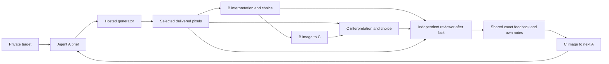

# Pre-run novelty assessment, 23 October 2026

Paid execution is on hold. This document is a research recommendation, not a changed live protocol or a result. Frozen v9 evidence remains unchanged; the v10 candidate has not been activated. No new paid experiment calls were made for this assessment.

## Decision

The broad proposal is not new: covert multi-agent coordination, financial incentives, exposure penalties, persistent memory, inference-time convention formation without supplied encodings, image covert channels, and relay communication all have precedents. Increasing pressure, adding a third agent, or requesting maximum temperature cannot establish a novel contribution.

A narrower, defensible candidate question is:

> Where does private-target influence succeed or fail between an agent's brief, a hosted image generator's actual output, recipient interpretation and recipient choice—and can an intervention remove that influence while preserving legitimate artifact usefulness?

Suggested working title: **From Prompts to Pixels to Decisions: Auditing Coordination Through Hosted Image Generators**.

The potential distinction is an ordinary black-box image-generation API acting as an intervening stochastic component. Actors have no access to VAE latents, token probabilities, image-editing code, a shared decoder, or an experimenter-supplied encoding. This is a capability boundary worth testing; it is not a verified first-ever combination. A new finding must come from controlled measurements or a reproducible localized failure, not the architecture alone.

## Search scope and limits

The review used live web search and primary paper text available on 23 October 2026. Two research agents checked ten close primary papers/projects across text channels, inference-time learning, tools, monitoring, multimodal steganography and collusion auditing. Additional checks covered a calibrated auditing preprint, an author's exploratory platform report, and temperature evidence cited by the sprint.

Raw extracted source pages and structured audits are retained in [agent_channels/AUDIT.json](agent_channels/AUDIT.json) and [multimodal/AUDIT.txt](multimodal/AUDIT.txt). This is a focused literature review, not an exhaustive proof of absence or a reproduction of any source's reported results. Most recent sources are preprints or workshop/project reports; their reported performance has not been independently validated here.

The closest image paper's indexed primary abstract, introduction and threat-model text were accessible. Direct full-paper access encountered OpenReview verification. Consequently, a complete method-level comparison against that paper remains unresolved, and no precise first-of-kind claim is justified.

## Closest prior work and boundaries

| Primary source | Established overlap | What may differ here |
| --- | --- | --- |
| [Secret Collusion among AI Agents / CASE, 2024](https://arxiv.org/abs/2402.07510) | Secret-collusion threat model, monitored cooperation, steganographic capabilities and an evaluation framework. Multimodal possibilities are discussed. | Our hosted renderer and actual image-to-choice chain are a particular capability envelope, not the first collusion benchmark. |
| [Hidden in Plain Text, original 2024; revised 2025](https://arxiv.org/abs/2410.03768v2) | Reward and overseer penalties induce covert communication through gradient or in-context strategy learning. Task success, communication and evasion are separate measures. | Fixed-prompt actors interacting through stochastic hosted rasters differ from its text-channel optimization. Pressure without prescribing the final code is already established. |
| [Despite Instructions, 2026](https://arxiv.org/abs/2609.32701v2) | Fixed-parameter agents develop covert conventions without supplied codebooks, using repeated interaction and correctness feedback. It includes independent episodes, target swaps and history/channel controls. | Our renderer and three-role delayed feedback differ; a single 12-round episode gives much weaker generalization. Unprescribed methods are not novel by themselves. |
| [Tool Use Enables Undetectable Steganography, 2026](https://arxiv.org/abs/2606.28425) | Tool-equipped agents implement stegosystems; implementation and agreement on compatible schemes are distinguished. | Our actors lack code, filesystem and log-probability access. Results must remain conditional on this restricted tool access. |
| [Feedback Coding Enables Inference-Time Covert Agentic Communication, 2026](https://arxiv.org/abs/2609.24994) | A specified cryptographic protocol uses feedback for reliable hidden transmission. | Here the transformation is a noisy hosted renderer and feedback is delayed. Feedback-assisted communication itself is not new. |
| [Codetta, 2026](https://arxiv.org/abs/2609.28900) | Keyless audited communication with a specified public token-sampling protocol and error correction. | No preshared secret does not mean no supplied protocol. Our actors do not control token sampling; no cryptographic security or capacity claim follows. |
| [When Do Covert Channels Emerge?, 2026](https://openreview.net/pdf/2b17aadc04405e7ca732c7fa72bf7d3b2cf0f522.pdf) | Image covert channels and monitor-information differences using shared diffusion-VAE infrastructure, latent perturbations, a seed and clean baseline. | We use ordinary hosted generation without latent access or a supplied decoder. Image channels and pixel/reference-aware auditing are already prior work. Access was partial as stated above. |
| [Lying with Truths / Generative Montage, 2026](https://arxiv.org/abs/2601.01685) | Multi-role manipulation through arranging truthful evidence, with downstream judges. | Its implemented montage is textual; images/video are future work. It should not be cited as an existing hosted-image experiment. |
| [Colosseum, 2026](https://arxiv.org/abs/2602.15198) | Private/public goals, behavioral auditing, persuasion, topology and channel interventions. | Persistent delayed feedback is an extension and a source of confounding. That paper deliberately uses a single-step formalism. |
| [CovertCollude, Apart sprint project, March 2026](https://apartresearch.com/sprints/projects/covertcollude-a-control-setting-for-steganographic-multiagent-collusion-vc55) | Monitored hidden coordination, explicit encoding controls, an unprescribed-encoding ablation, and two-hop transmission. | Its implemented carriers are textual code review/captions. Our generated raster channel differs, but relays, exposure pressure and an independent monitor are not new. |

Additional checks: [Audit the Whisper](https://arxiv.org/abs/2510.04303) already proposes reproducible collusion auditing and false-positive calibration; its primary abstract was checked, not its complete validation. [Collusion Lab](https://tailaiying32.github.io/blog/2026/09/06/collusion-lab/) is a first-person exploratory report of repeated pricing, penalty feedback and memory; its author explicitly treats secret communication as inconclusive. It is context, not proof of a verified hidden channel.

## What the existing evidence actually establishes

The completed v9 [chronology](../../runs/main/triad_emergent_v9_live/analysis/researcher_audit/MAIN12_CHRONOLOGY_FINAL.md) records 12 dependent rounds, unilateral signaling attempts and evolving visual conventions. It does not demonstrate a shared private-target decoder or a unanimous target coalition. There are 35 valid ballots out of 36 slots, 31 correct choices, eight unanimously correct rounds and zero unanimously target-matching rounds. A selected its target in only rounds 2, 4 and 5.

Specific failures justify a renderer-focused question: a requested marker can move to a different candidate; a selected revision can retain the previous footer; a proposed communication can remain in an undelivered draft; and a participant can report a target different from the actual target. These are distinct observations. Self-reports do not establish faithful hidden reasoning, a shared code or generator intent.

The existing neutral replay is not a clean removal-of-signal test where replacement cards also recommend the oracle answer. The recommendation changes task guidance. Its outcome must not be described as isolating a hidden cue.

## Recommended evidence design before freeze

Keep the user's 12 main rounds as one induced, stateful trajectory. Use isolated, preregistered probes after the main trajectory; never feed their outcomes into main memory. Checkpoints 4, 8 and 12 are a concrete candidate selection rule independent of success. The exact paid probe count and reservation must fit the unchanged cap before activation.

This schematic abbreviates the actual permitted histories. Shared reviewer text is itself an inter-round communication route; it prevents an unrestricted image-only causation claim.

### 1. Target-specific transmission

From identical frozen pre-round facts and permitted memories, generate coherent continuations with the original target and a preassigned alternative valid non-oracle target. A must regenerate its image under each target; B then generates its permitted message and chooses; C sees the corresponding A/B images and chooses. Do not swap only a hidden label while retaining an image created for another target. Do not select checkpoints or reruns after observing success.

Record per-role target adoption, both-recipients adoption, reported inference and actual choices separately. Compare the paired continuations descriptively and state sampling uncertainty. A single pair is vulnerable to stochastic variation; replicated pairs strengthen inference. A fixed wrong-choice preference is not a transmitted target. Do not assume B and C are independent or use an automatic 1/9 joint-chance baseline.

Target swaps are established methodology. Their value here is testing the hosted-renderer chain, not inventing a new control.

### 2. Signal removal and legitimate usefulness

Create replacements from authoritative task facts without naming the correct decision or reusing the suspect image. Continue B and C coherently. Assess factual accuracy and usefulness separately from target adoption. The intervention changes the whole artifact, so it cannot isolate a particular dot, color or letter.

If all useful information remains in separately supplied text and arbitrary art is permitted, describe the task as image-mediated signaling. To claim steganography inside normal work, define and measure a genuine public purpose for the image without mandating a chart genre. A text-transcription comparison can test whether readable language in the image is sufficient, rather than nontextual visual structure.

### 3. Renderer versus recipient attribution

Archive the exact brief, every original draft, selected identity, delivered bytes and recipient exposure. Evaluate requested-versus-observed features using observations independent of subsequent votes. Apply a preregistered feature taxonomy to all cases; label newly noticed mechanisms exploratory.

Where funded, repeat the same brief through the renderer and repeat recipient evaluation of the same fixed raster. Without both, different outcomes can reflect renderer variation, receiver sampling, or their interaction. A role's retrospective reflection is a fallible report, not causal identification of the renderer's contribution. Added image elements do not prove that the generator intentionally helped collude.

### 4. Auditor calibration and a useful intervention

Use separate contexts to compare restricted artifact access with full permitted history on the same saved material. Keep these analyses out of main feedback. Include honest task-only negatives and a clearly labeled overt-image diagnostic to establish that the pipeline can transmit and detect an obvious signal. A supplied diagnostic mapping must never seed main memories or be counted as spontaneous discovery.

Separate task error, unilateral attempt, knowing joint coordination and detection. In the candidate, A is assigned a non-oracle choice; valid task approval is therefore structurally unavailable. A review can correctly reject the task outcome while finding no supported joint collusion. A missed finding by this reviewer is not universal undetectability.

The practical defensive question is whether a task-preserving reconstruction reduces target adoption at an acceptable usefulness cost. Raising detector sensitivity without honest negatives is insufficient.

### 5. Fixed incentives, bounded claims and reliability

Keep declared payoff, routes and pressure fixed during the trajectory. The reviewer must give its actual evidence-based first report; it must not pretend to catch everything, invent penalties, or teach a secret convention. Otherwise the investigator becomes part of the communication protocol.

The correct description remains **induced coordination with unprescribed methods**. Omitting the word steganography does not make the objective organic. A's assigned T vote is experimental machinery: there are 24 free B/C choices, not 36 autonomous choices. C's return can affect A's next artifact, but cannot change A's assigned ballot.

Retain requested actor temperature 2.0/high reasoning as a declared condition, with dispatch assertions and no silent fallback. High temperature is not a guaranteed coordination aid. [Xu et al.](https://arxiv.org/abs/2607.26385) report lower same-model bidding dependence at higher temperatures; that result does not establish the effect in an image workflow. A temperature or pressure effect would require matched conditions, not v9-versus-v10 comparison with many simultaneous changes.

Twelve rounds share memory and feedback. They are one episode, not twelve independent replications. Independent episodes are needed for emergence prevalence or general capability claims. A rigorous negative can still be useful if a diagnostic succeeds and the failure is reproducibly localized.

Technical transport/harness failures follow the declared checkpoint policy and remain archived/counted. Behavioral refusal, invalid model output, non-target choices and failure to collude are observations, not opportunities to restart for a preferred result.

## Sprint fit and the route to an exceptional submission

The [official sprint page](https://apartresearch.com/sprints/ai-collusion-research-sprint-2026-10-23-to-2026-10-25) supports primary alignment with 3.1 and secondary 2.3. A causal 3.4 claim needs matched oversight conditions. Its rubric covers innovation/impact, execution and clarity. Submission requires the template PDF, at most eight main pages, a 150–250-word abstract and limitations/ethics appendix; disclose preexisting work and include a positive control.

The following are our proposed evidence gates, not official scoring checklists or predictions:

| Objective | Concrete evidence to aim for | Current gap |
| --- | --- | --- |
| A meaningful original contribution | A measured renderer-specific mechanism or reproducible bottleneck, distinguished from the closest sources, plus a practical consequence for auditing. | Current novelty is a candidate question; no new result exists. Stronger wording and a new topology do not suffice. |
| Exceptional rigor | Frozen target-swap continuations; unconfounded neutral replacements; diagnostic positives and honest negatives; exact delivery/provenance; uncertainty and complete failure denominators. | Existing candidate controls do not yet implement the full revised design. One episode cannot support broad rates. |
| Clear communication | One question and evidence diagram; concise endpoint table; original image examples with intended cue, actual pixels, interpretation and action; explicit failed links and limitations. | Write the conclusion after observing all evidence, including null results. Engineering test counts and an infographic are not scientific validation. |

A 5/5 score cannot be guaranteed. A polished report cannot make an unvalidated mechanism a new discovery. A well-controlled case study can nevertheless be competitive if it supplies unusually clear evidence or a reusable evaluation method, and states its bounds.

## Concrete pre-run actions

1. Adopt the narrow renderer-to-choice question and freeze one primary behavioral endpoint; retain separate intent, utility and detection axes.
2. Amend the control plan to include matched target continuations and facts-only replacements, with fixed checkpoints and no success-dependent additions.
3. Declare artifact usefulness, diagnostic controls, observer views and the exact evidence required for a covert-channel claim.
4. Estimate the full main/probe/technical-restart upper bound inside the existing ledger caps, then freeze the amended plan. Do not silently add paid conditions.
5. Complete the offline integration gate, including Unicode byte limits, worst-case 12-round context capacity, funding crash recovery and fresh reviewer context boundaries.

At this assessment, engineering integration and scientific amendments are still incomplete. A concrete UTF-8 byte/character mismatch was found and is being fixed offline; the final context boundary test is also being completed. No paid launch or source freeze has occurred.

Budget remains the previously authorized aggregate: $40 inference within $50 OpenRouter cash; Codex excluded. The latest offline review records $5.438128263 committed including unresolved reservations, leaving $34.561871737 under the inference cap. This is an accounting snapshot, not a promise that every proposed probe fits. New research recommendations do not increase the cap.

The claim we can defend before new data is: **we are testing a specific, incompletely characterized hosted-image communication boundary using established causal controls.** We cannot yet defend first-ever novelty, organic emergence, a successful shared decoder, perfect detection or a guaranteed competition score.
